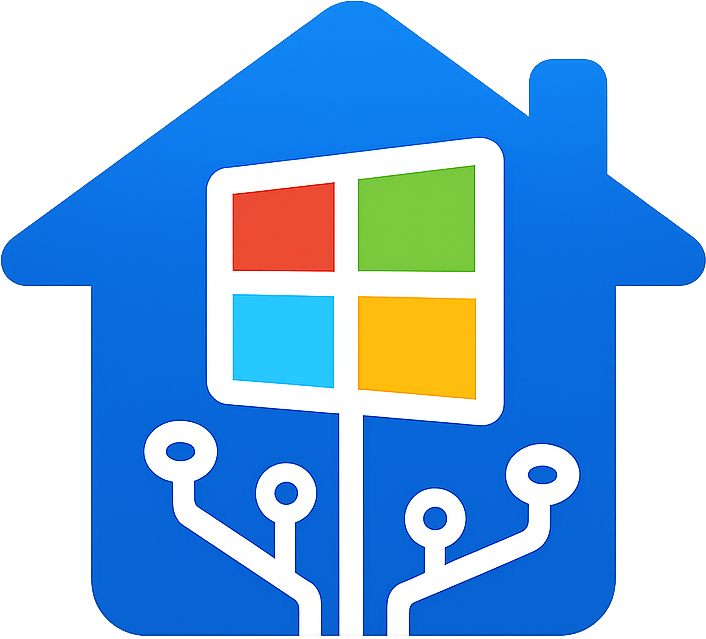

<p align="center"></p>
<h1 align="center">HA Win</h1>

A small native Windows 10/11 client connecting your PC to Home Assistant over MQTT.
Version 1.0.0 replaces the previous C#/WPF application with Rust. No .NET runtime,
WebView, or browser is required.

## Features

- Home Assistant MQTT discovery: restart, shutdown, standby, and notifications
- Native settings window with Status, MQTT, and App tabs
- Bold MQTT status: green when running, red when disconnected
- Tray icon: click to open settings, right-click to open or exit
- Closing the settings window keeps the client running in the tray
- MQTT credentials, TLS using the Windows certificate store, connection test, and reconnect
- Windows toast notifications with tray balloon fallback
- Start with Windows, optional hidden startup, optional update check on launch
- GitHub update check and installer download, with confirmation before installation

## Install and run

For everyday use, download and run `HA-Win-Setup.exe` from the
[latest release](https://github.com/derDeno/HA-Win/releases/latest). It provides
Start Menu shortcuts, an uninstaller, and a stable installation path for autostart
and updates. Releases before 1.0.0 contain the C# version.

For testing or running without installation, extract `HaWin-win-x64.zip` and run
`HaWin.exe`. The EXE needs no companion runtime files, so a standalone download
remains useful. This is not a fully portable profile: settings stay in AppData,
notifications register an application identity for the current Windows user, and
enabling autostart adds a registry entry pointing to the current EXE path. Keep
the EXE in a permanent folder if you enable autostart. Accepting an update launches
the installer and switches you to an installed copy.

1. Open settings from the tray icon.
2. Enter your MQTT host, port, and optional credentials. Enable TLS if required by
   your broker (usually port 8883). Use a hostname matching its certificate.
3. Test the connection, then Save.
4. Home Assistant discovers the device automatically when its MQTT integration is enabled.

To check for a new version manually, open the **App** tab and select
**Check now for updates** below **Check for updates on launch**.

The Namespace defaults to the PC name. Spaces and hyphens become underscores,
letters become lowercase, and other punctuation is removed. Keep your existing
namespace and client ID when switching versions to retain the same HA entities.
Stop the C# client before starting the Rust client to avoid duplicate MQTT client IDs.

Settings are read from `%APPDATA%\HA Win\settings.json`, using the same PascalCase
JSON fields as the C# version. Legacy `%APPDATA%\HaWin\settings.json` is copied on
first launch if needed. Saves replace the file atomically; invalid JSON is reported
without overwriting it. MQTT passwords remain in this local file as in the original.
Uninstalling preserves these settings.

## MQTT

| Purpose | Topic | Payload |
| --- | --- | --- |
| Restart | `ha-win/<device-id>/restart/set` | `PRESS` |
| Shutdown | `ha-win/<device-id>/shutdown/set` | `PRESS` |
| Standby | `ha-win/<device-id>/standby/set` | `PRESS` |
| Notification | `ha-win/<device-id>/notify` | Plain text or JSON |
| Availability | `ha-win/<device-id>/status` | `online` / `offline` (retained) |

Notification JSON: `{ "title": "Door", "message": "Front door opened" }`.
Missing or non-string fields fall back to the default title/plain payload.

Discovery topics and unique IDs match the original client. Discovery is retained
and republished after reconnect and on Home Assistant's `homeassistant/status`
birth message. The client publishes `offline` on exit and sets a last will for
unexpected disconnects. Retained action and notification commands are ignored so
old commands do not replay on reconnect. Restrict publishing to these command
topics to trusted Home Assistant users through your MQTT broker's ACLs.

## Build (Windows x64)

Install [Rust stable](https://www.rust-lang.org/tools/install) with the MSVC target
and [Visual Studio Build Tools](https://visualstudio.microsoft.com/downloads/)
with **Desktop development with C++** and a current Windows SDK.

```powershell
cargo run --locked
cargo test --locked
cargo clippy --locked --all-targets -- -D warnings
cargo build --release --locked
```

The release executable is `target\release\HaWin.exe`; its application icon and
version metadata are embedded. Tests cover settings compatibility, discovery,
command parsing, update selection, reconnect, and an MQTT exchange with a local test broker.
Tests never run PC power actions or install updates.

The UI uses native Win32 controls through `native-windows-gui`, MQTT uses `rumqttc`,
and toast/power integration uses the Windows APIs. Network operations run outside
the UI thread. To debug in VS Code, install rust-analyzer and CodeLLDB.

## Packaging

With [Inno Setup 6](https://jrsoftware.org/isinfo.php) installed:

```powershell
cargo build --release --locked
New-Item -ItemType Directory -Force artifacts/publish
Copy-Item target/release/HaWin.exe, LICENSE.md, README.md artifacts/publish
& 'C:\Program Files (x86)\Inno Setup 6\ISCC.exe' /DAppVersion=1.0.0 installer/ha-win.iss
```

The installer retains the existing product identity and installation directory for
upgrades. CI checks formatting, Clippy, tests, and release compilation on Windows.
The release workflow creates the ZIP and installer and drafts a GitHub release
after merging a PR to `main`, or when manually triggered. Bump `Cargo.toml` before
each release; the version tag must not already exist.

## Branches and license

`dev` contains the Rust implementation. `legacy` preserves the .NET implementation
from `main` before the migration; its source remains available there and in Git
history. `main` receives releases by merging development PRs.

The current project license is included in [LICENSE.md](LICENSE.md).
